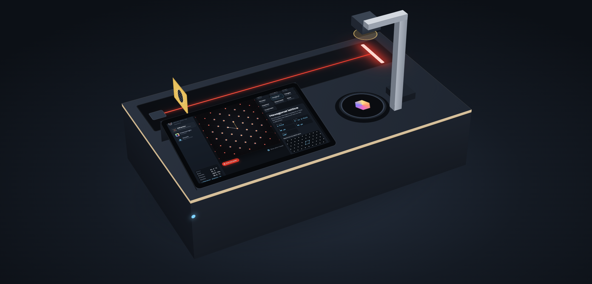
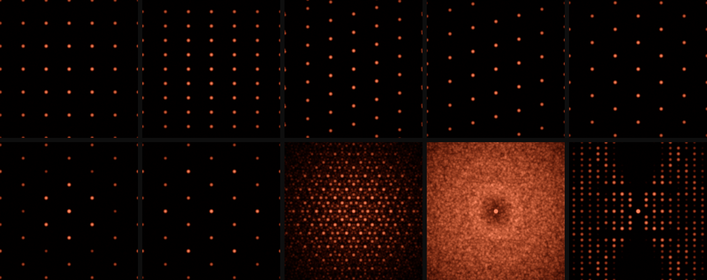
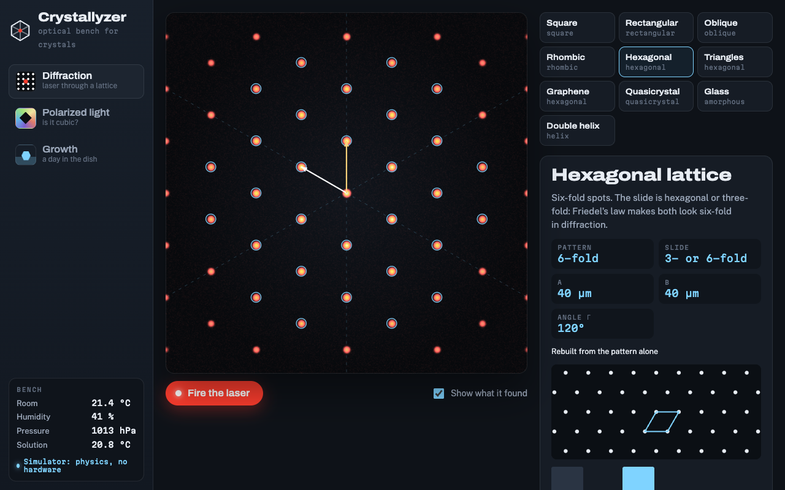
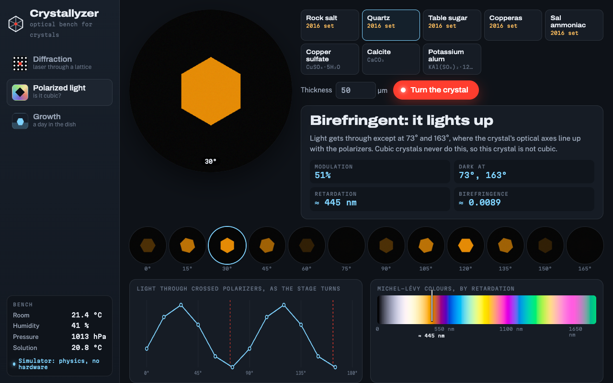
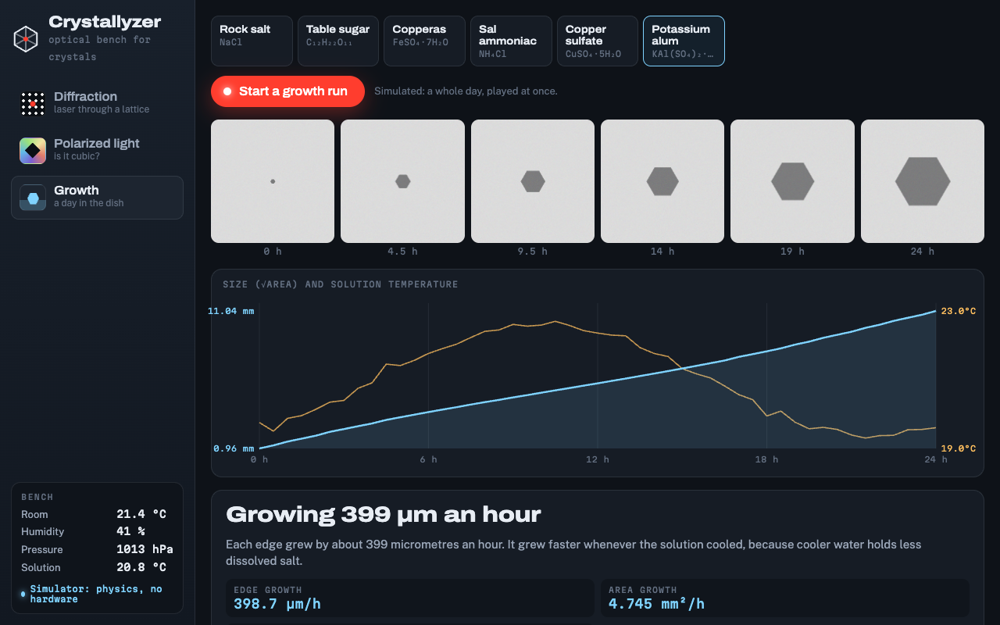
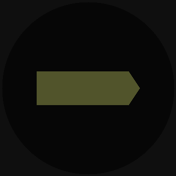
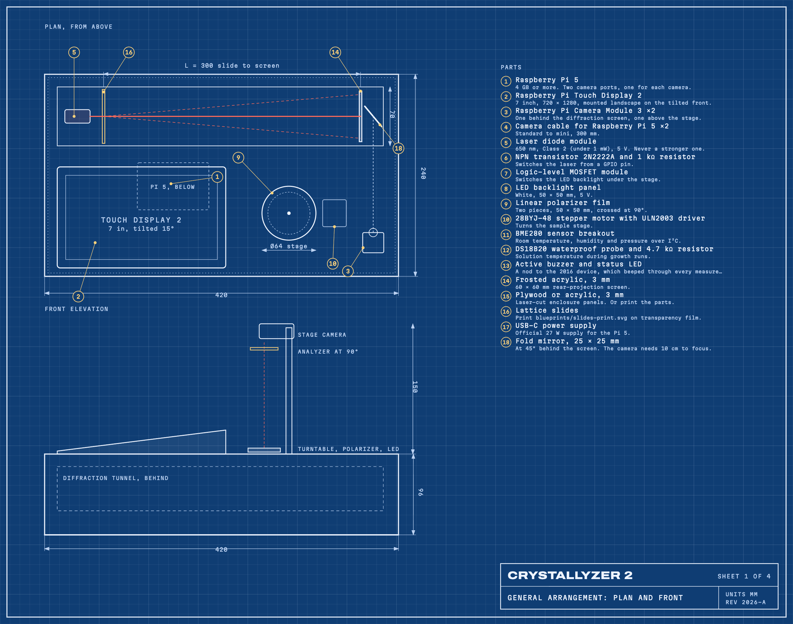
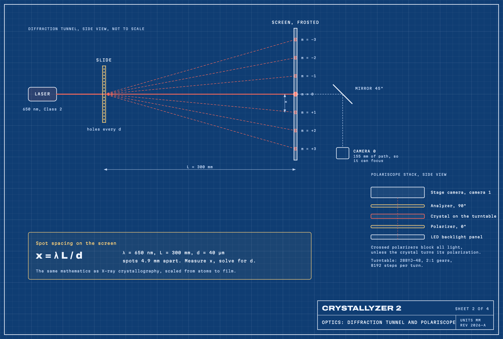
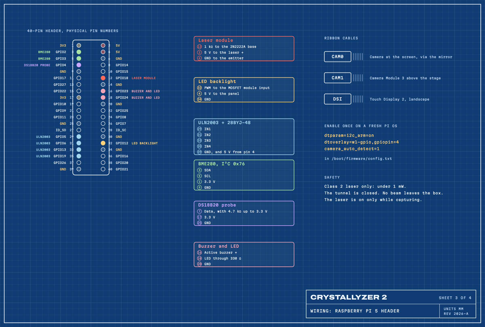
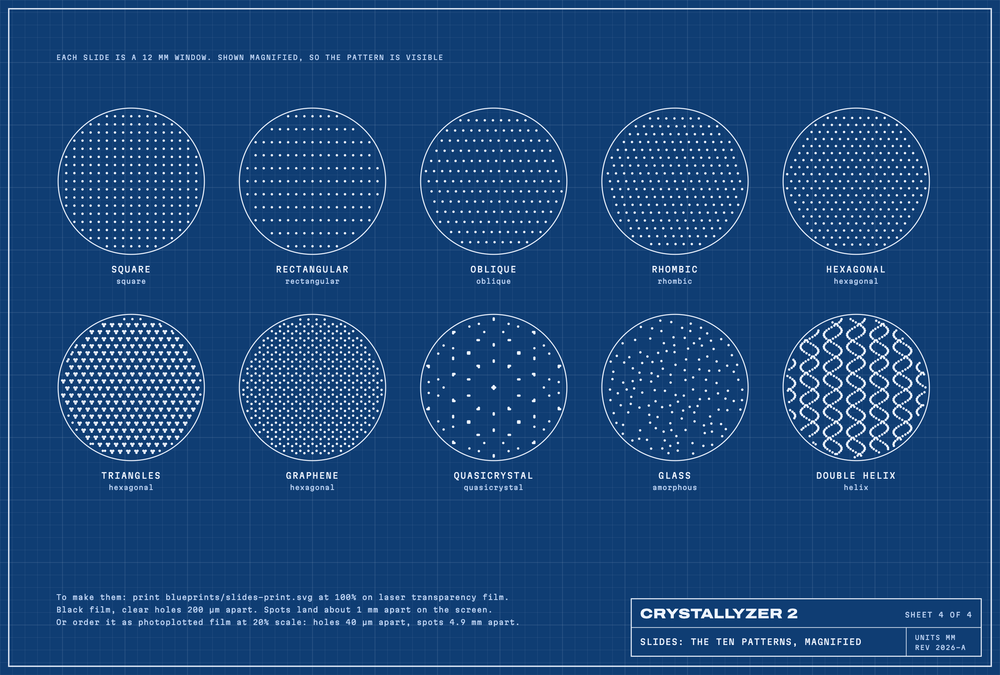

<p align="center">
  
</p>
<p align="center"><sub>Illustration drawn from the blueprint dimensions. The hardware has not been built yet; the software runs today, with a physics simulator in place of the bench.</sub></p>

<h1 align="center">Crystallyzer</h1>
<p align="center"><b>A Raspberry Pi optical bench that reads crystals with light.</b><br>Shine a laser through a lattice and read its symmetry. Turn a crystal between polarizers and learn whether it is cubic. Watch one grow for a day.</p>

<p align="center">
  <a href="https://github.com/nesdown/Crystallyzer/actions/workflows/ci.yml"></a>
  
  
  
  
</p>

<p align="center">
  <a href="#three-experiments"><b>Experiments</b></a> &nbsp;·&nbsp;
  <a href="#blueprints"><b>Blueprints</b></a> &nbsp;·&nbsp;
  <a href="#build-it"><b>Build it</b></a> &nbsp;·&nbsp;
  <a href="#try-it-without-hardware"><b>Try it</b></a> &nbsp;·&nbsp;
  <a href="#how-well-it-works"><b>Accuracy</b></a> &nbsp;·&nbsp;
  <a href="#from-2016"><b>From 2016</b></a>
</p>

<br>

<p align="center">
  
  <br>
  <sub>Ten slides, ten patterns. Top: square, rectangular, oblique, rhombic, hexagonal. Bottom: triangles, graphene, quasicrystal, glass, double helix.</sub>
</p>

<br>

## Three experiments

<table>
  <tr>
    <td width="60%"></td>
    <td>
      <h3>Diffraction</h3>
      <p>A red laser shines through a printed lattice slide onto a screen. The camera reads the spots, finds the symmetry, measures the spacing, then rebuilds the lattice from the pattern alone.</p>
      <p>It tells square, rectangular, oblique, rhombic and hexagonal lattices apart, finds the ten-fold order of a quasicrystal, the ring of a glass and the X of a double helix.</p>
    </td>
  </tr>
  <tr>
    <td>
      <h3>Polarized light</h3>
      <p>A crystal turns between two crossed polarizers. Cubic crystals, like rock salt and alum, stay dark at every angle. Everything else lights up and goes dark every 90°, glowing in its own interference colour.</p>
      <p>The colour gives the retardation. Add the thickness and you get the birefringence, a number from a mineralogy table.</p>
    </td>
    <td width="60%"></td>
  </tr>
  <tr>
    <td width="60%"></td>
    <td>
      <h3>Growth</h3>
      <p>Leave a dish of saturated solution on the stage overnight. The top camera measures the crystal every five minutes while a probe logs the solution temperature.</p>
      <p>It reports how fast the crystal grew, and whether it grew faster as the room cooled.</p>
    </td>
  </tr>
</table>

<p align="center">
  
  <br>
  <sub>Table sugar turning between crossed polarizers: dark twice per half turn, bright in between.</sub>
</p>

<br>

## The science in one box

> **Spot spacing on the screen: x = λ L / d**
>
> With a 650 nm laser and the screen 300 mm away, a slide with holes 40 µm apart puts its spots 4.9 mm apart. Measure x, and you know d. This is the mathematics of X-ray crystallography, scaled up from atoms to film so a red laser can show it.

Three things worth knowing, all of which the app tells you when they apply:

- **Friedel's law.** A diffraction pattern is always symmetric through its centre. A three-fold lattice therefore makes a six-fold pattern, and the app says "3- or 6-fold" rather than pretending to know.
- **The forbidden symmetry.** A repeating crystal can only be 2, 3, 4 or 6-fold. Five-fold order was thought impossible until Dan Shechtman found quasicrystals in 1982, and won the 2011 Nobel Prize for it. The quasicrystal slide shows that ten-fold pattern.
- **The double helix.** The X-shaped pattern on the DNA slide is the same signature Rosalind Franklin captured in Photo 51.

<br>

## Blueprints

Drawn by [`blueprints/make.py`](blueprints/make.py) from [`crystallyzer/device.py`](crystallyzer/device.py), the same numbers the software uses, so the drawings and the code cannot disagree.

<table>
  <tr>
    <td width="50%"><a href="blueprints/1-device.svg"></a><p align="center"><sub><b>1</b> General arrangement, with the parts list</sub></p></td>
    <td width="50%"><a href="blueprints/2-optics.svg"></a><p align="center"><sub><b>2</b> Optics: the tunnel and the polariscope</sub></p></td>
  </tr>
  <tr>
    <td width="50%"><a href="blueprints/3-wiring.svg"></a><p align="center"><sub><b>3</b> Wiring, pin by pin</sub></p></td>
    <td width="50%"><a href="blueprints/4-slides.svg"></a><p align="center"><sub><b>4</b> The ten slides, magnified</sub></p></td>
  </tr>
</table>

<br>

## Build it

| # | Part | Notes |
|---|---|---|
| 1 | Raspberry Pi 5 | 4 GB or more. Two camera ports, one for each camera. |
| 2 | Raspberry Pi Touch Display 2 | 7 inch, 720 × 1280, mounted landscape on the tilted front. |
| 3 | Raspberry Pi Camera Module 3 ×2 | One behind the diffraction screen, one above the stage. |
| 4 | Camera cable for Raspberry Pi 5 ×2 | Standard to mini, 300 mm. |
| 5 | Laser diode module | 650 nm, Class 2 (under 1 mW), 5 V. Never a stronger one. |
| 6 | NPN transistor 2N2222A and 1 kΩ resistor | Switches the laser from a GPIO pin. |
| 7 | Logic-level MOSFET module | Switches the LED backlight under the stage. |
| 8 | LED backlight panel | White, 50 × 50 mm, 5 V. |
| 9 | Linear polarizer film | Two pieces, 50 × 50 mm, crossed at 90°. |
| 10 | 28BYJ-48 stepper motor with ULN2003 driver | Turns the sample stage. |
| 11 | BME280 sensor breakout | Room temperature, humidity and pressure over I²C. |
| 12 | DS18B20 waterproof probe and 4.7 kΩ resistor | Solution temperature during growth runs. |
| 13 | Active buzzer and status LED | A nod to the 2016 device, which beeped through every measurement. |
| 14 | Frosted acrylic, 3 mm | 60 × 60 mm rear-projection screen. |
| 15 | Plywood or acrylic, 3 mm | Laser-cut enclosure panels. Or print the parts. |
| 16 | Lattice slides | Print blueprints/slides-print.svg on transparency film. |
| 17 | USB-C power supply | Official 27 W supply for the Pi 5. |
| 18 | Fold mirror, 25 × 25 mm | At 45° behind the screen. Camera Module 3 needs 10 cm to focus. |

1. **Print the slides.** Print [`blueprints/slides-print.svg`](blueprints/slides-print.svg) at 100% on laser transparency film. Check the 10 mm bar with a ruler first.
2. **Cut the enclosure.** 3 mm plywood or acrylic, 420 × 240 × 96 mm, with a closed tunnel along the back. Sheet 1 has every position.
3. **Wire it.** Follow sheet 3. Every pin comes from `crystallyzer/device.py`, so if you change a pin, change it there.
4. **Install.** On a fresh Raspberry Pi OS:

```bash
git clone https://github.com/nesdown/Crystallyzer && cd Crystallyzer
./deploy/install.sh
```

5. **Check every part.** After a reboot, `crystallyzer check` lists what it found and what is missing, and how to fix it.
6. **Calibrate once.** Put a printed millimetre scale on the screen and on the stage, and set `screen_px_per_mm` and `stage_px_per_mm` in `crystallyzer/device.py`.

> **Laser safety.** Use a Class 2 laser module, under 1 mW, and nothing stronger. The beam stays inside the closed tunnel and is on only while a picture is taken.

<br>

## Try it without hardware

```bash
pip install -e .
crystallyzer serve --simulate      # open http://localhost:8080
crystallyzer diffract --simulate quasicrystal
crystallyzer polarize --simulate calcite
pytest -q
```

The simulator is real physics, not canned pictures. Diffraction patterns are computed as the Fourier transform of each slide. Polarized light uses the CIE colour-matching curves to produce true Michel-Lévy colours. Growth follows a temperature that drifts through the day. The analysis code cannot tell the simulator from the cameras.

<br>

## How well it works

| Measured in the simulator, by the tests | Result |
|---|---|
| Slides recognised, 10 slides × 3 noise levels | 30 of 30 |
| Lattice spacing, from the pattern | 40.0 µm read as 40.0 µm |
| Glass, typical spacing from the ring | within 15% |
| Cubic or not, 8 crystals | 8 of 8 |
| Birefringence from colour, 5 crystals | within 6% |
| Growth rate | within 12% |

> **Not yet tested on hardware.** No unit has been built, so the hardware code and the install script have not run on a real Pi. Real screens add glare and real crystals are rarely perfect, so expect to tune exposure and thresholds once the first bench exists. Reports from builders are the most useful contribution.

<br>

## From 2016

The first Crystallyzer was built for the Sikorsky Challenge in 2016: an Arduino with a thermistor, a light sensor and a resistance probe, and a Python window that matched the readings to a table of five crystals and showed a diffraction picture.

Its dream was right, but those sensors could not see a crystal's structure. Version 2 measures what really carries it: how a crystal bends and turns light.

| | 2016 | 2026 |
|---|---|---|
| Board | Arduino | Raspberry Pi 5, two cameras, 7 inch touchscreen |
| Measures | Temperature, light level, resistance | Diffraction patterns, polarized light, growth over time |
| Symmetry | Looked up from a light reading | Read from the pattern, with Friedel's law in mind |
| The five crystals | Rock salt, quartz, sugar, copperas, sal ammoniac | The same five, plus copper sulfate, calcite and alum |
| Fifth order | Shown as a picture | A quasicrystal slide you can shine a laser through |
| The beep | Every measurement | Still there, on GPIO 23 |

<br>

## Inside

```
crystallyzer/slides.py        the ten slides and the diffraction physics
crystallyzer/diffraction.py   symmetry, lattice and spacing from a pattern
crystallyzer/polarization.py  crossed polarizers and Michel-Lévy colours
crystallyzer/growth.py        crystal size and growth rate
crystallyzer/hardware.py      the real bench, and a simulator with the same interface
crystallyzer/server.py        the touchscreen app's API
crystallyzer/web/             the touchscreen app
crystallyzer/device.py        every dimension and pin, read by the code and the blueprints
blueprints/                   the four sheets and the printable slides
deploy/                       install script, service and kiosk launcher
tests/                        the tests behind the accuracy table
```

<br>

<p align="center"><sub>MIT. By Bohdan Hlushko. Sikorsky Challenge 2016, redrawn in 2026.</sub></p>
